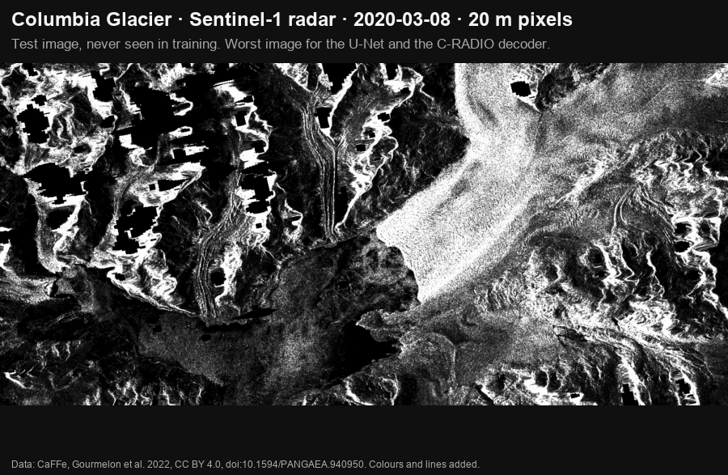
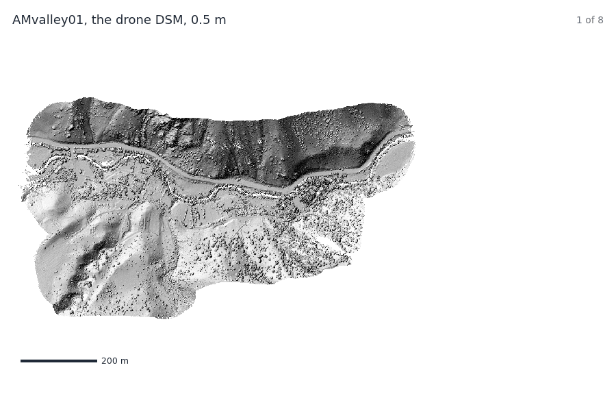
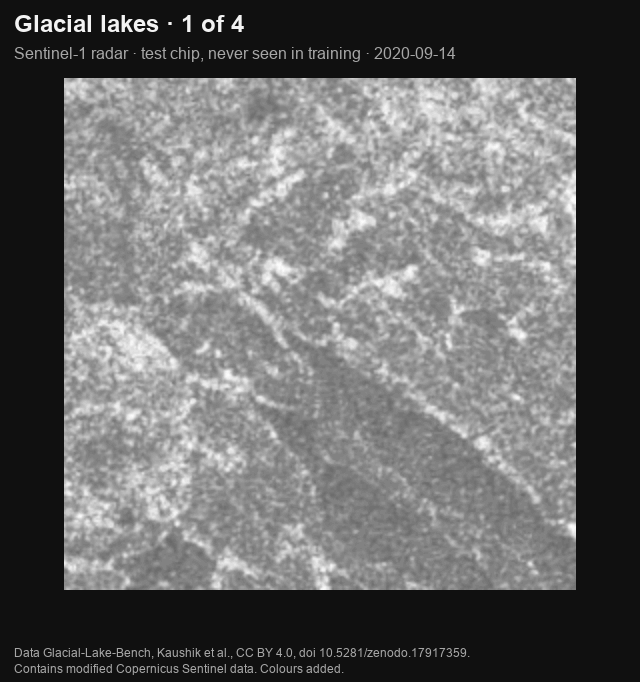
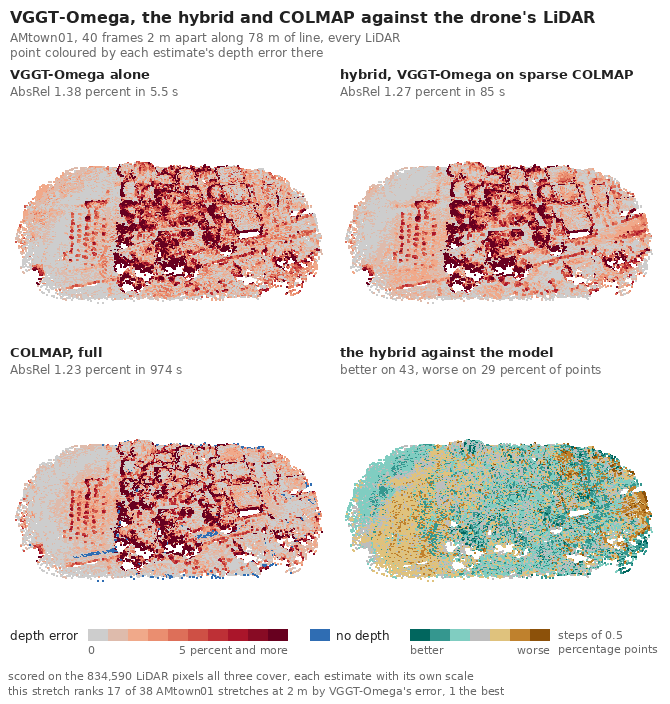

<table>
<tr>
<td width="50%"></td>
<td width="50%"></td>
</tr>
<tr>
<td></td>
<td></td>
</tr>
</table>

<a href="https://saverin0.github.io">saverin0.github.io</a>

Picture credits

Figure data from CaFFe (Gourmelon et al. 2022, CC BY 4.0), Glacial-Lake-Bench (CC BY 4.0), SnowSAR replication data (Etalab Open Licence 2.0), ForTy v1 (CC BY-SA 4.0), the GlaViTU tile dataset (CC BY 4.0), and MARS-LVIG and UAVScenes (CC BY-NC-SA 4.0) with Copernicus GLO-30, ESA WorldCover, the Meta and WRI canopy height map, Sentinel-2 and OpenStreetMap contributors (ODbL).

